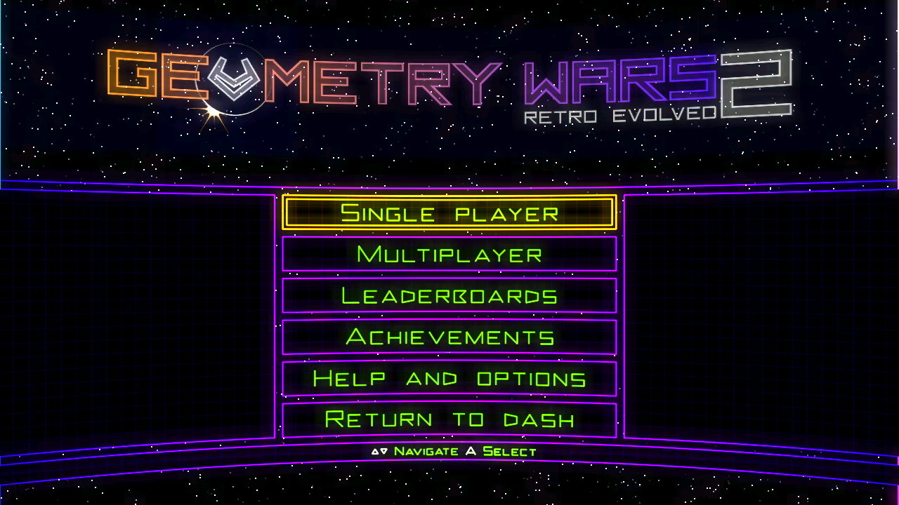
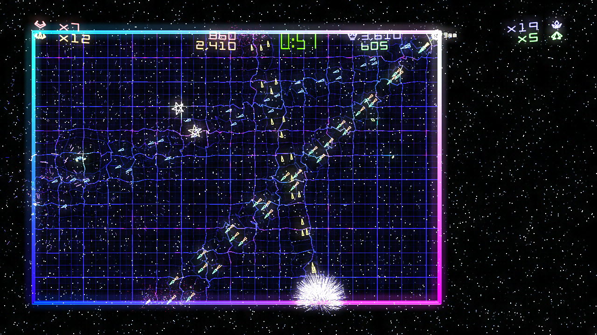
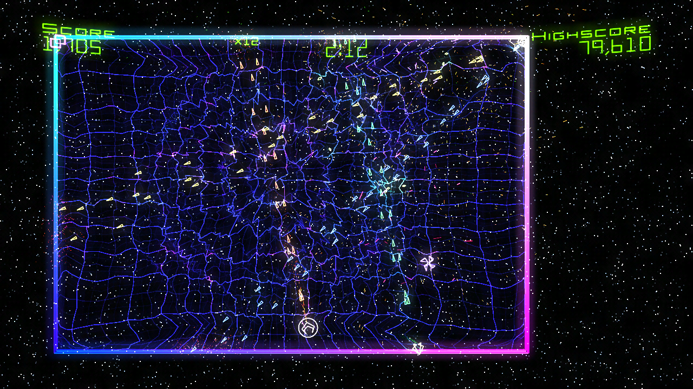
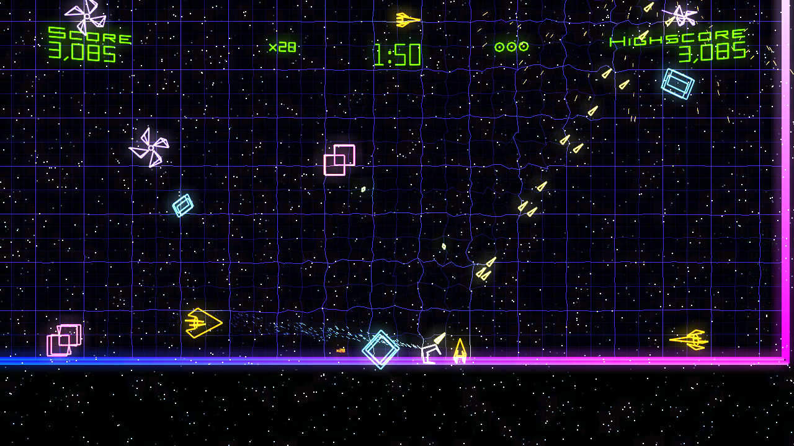

<div align="center">

# Geometry Wars: Retro Evolved 2 for the original Xbox

### The Xbox 360 game, statically recompiled and running natively on a stock 64 MB original Xbox, with four-player multiplayer, sound and saves

[](https://github.com/GTTeancum/geometry-wars-retro-evolved-2-recompiled/releases/latest)
-107c10?style=for-the-badge&labelColor=07101f)

<sub>Built on the <a href="https://github.com/saulob/geometry-wars-retro-evolved-2-recompiled">Geometry Wars: Retro Evolved 2 PC port</a> (ReXGlue static recompilation) and <a href="https://github.com/XboxDev/nxdk">nxdk</a>. <b>No game files included</b>: the installer prepares the game from your own Xbox Live Arcade package.</sub>

</div>



| | |
| --- | --- |
|  |  |
| Four players, versus (captured on an Xbox) | Four players, co-op (captured on an Xbox) |



## About

This is Geometry Wars: Retro Evolved 2 on the original Xbox. The game's own
Xbox 360 code is recompiled to x86 and runs on the Xbox's Pentium III, with a
small runtime of our own in place of the Xbox 360's: an NV2A renderer for the
game's graphics, a sound engine that plays the game's sound graphs, and the
kernel and system services the game expects. It fits in the stock 64 MB.

**v0.8.0 beta** is the first public release. It is a beta: expect rough
edges, and please report what you find.

## Features

- All of the game's single-player modes and four-player versus and co-op
- Full game speed: the game runs its 60 updates a second (58.6 median with
  four players on a console) and draws every second one, 30 pictures a second
- 720p output when 720p is enabled in the Xbox dashboard's video settings,
  otherwise 480p (letterboxed on a 4:3 TV)
- Music and sound effects, converted by the installer to the Xbox's own
  ADPCM format
- Saves on the Xbox hard disk (`E:\UDATA\584108FF`), with the game's icon
  in the dashboard's memory manager
- The game's name and icon on your dashboard
- In-game reset: hold **LT + RT + Back + Black** on any controller, or pick
  **Return to dash** on the main menu
- English text (the game's other languages are installed but not used yet)

## What you need

- **An original Xbox that can run homebrew** (a softmod or modchip), with
  the stock 64 MB of memory. About 140 MB free on the hard disk.
- **A Windows 10 or 11 PC** to run the installer (it uses the PowerShell
  that comes with Windows), with **[ffmpeg](https://ffmpeg.org)** on the
  PATH or `ffmpeg.exe` placed next to `install.ps1`. Without ffmpeg the game
  installs but has no sound.
- **Your own Geometry Wars: Retro Evolved 2 Xbox Live Arcade package**, this
  exact version (the same one the PC port supports):

| | |
| --- | --- |
| Game | Geometry Wars: Retro Evolved 2, Xbox Live Arcade |
| Title ID | `584108FF` |
| Content type | `000D0000` (Xbox Live Arcade), STFS `LIVE` package |
| Game version | `0.0.1.2` |
| `default.xex` | 704,512 bytes, SHA-256 `6D5D9980A1D17DC74B9CCF540CEC16C2E144E7CEE3A74938E78C237B8ACEEB88` |

The package is one file with a long hexadecimal name and no extension. On an
Xbox 360 drive it is in `Content\0000000000000000\584108FF\000D0000\`. The
installer checks that it is this game and this version, and refuses any other.

## Installing

1. Download **gw2-xbox-v0.8.0-beta.zip** from the
   [latest release](https://github.com/GTTeancum/geometry-wars-retro-evolved-2-recompiled/releases/latest)
   and unzip it to a folder.
2. Open a command prompt in that folder and run:

   ```
   install.cmd "<your LIVE package>" "<new output folder>"
   ```

   For example: `install.cmd "D:\360\584108FF\000D0000\8343...FDAD58" "D:\GW2 Xbox"`.
   The output folder must be new or empty. Converting the sounds takes a
   few minutes.
3. Copy the whole output folder to your Xbox's hard disk (with FTP, for
   example to `E:\Games\Geometry Wars 2`).
4. Start `default.xbe` from your dashboard.

Nothing is written anywhere except the output folder and a temporary
folder, removed at the end. The download contains no game files, art or
sound: everything the game needs comes from your package.

## Controls

The game's own controls, on the Xbox controller:

| | |
| --- | --- |
| Move | Left stick |
| Fire | Right stick |
| Bomb | Left or right trigger |
| Pause | Start |
| Reset to the dashboard | Hold LT + RT + Back + Black |

Up to four controllers. Players join on the multiplayer screen by pressing A.

## Known issues and limits

- **Xbox Live features are not available**: the leaderboards show the
  game's own "not available while offline" message, and no Xbox Live
  achievements are awarded.
- **Tested on an Xbox development kit running at 64 MB and in XEMU.** A
  retail console should behave the same, but this release has not been
  tried on one yet: reports are welcome.
- The picture is drawn at 30 frames a second while the game itself runs at
  its full 60 updates a second.
- At most 16,000 particles are shown at once (about three times the busiest
  moment seen in four-player play), so the game cannot run out of memory in
  an extreme explosion.
- One piece of music (Song 3's transition) has only been checked in the PC
  sound tester, not heard on an Xbox. If the music behaves oddly in a mode,
  please report which one.

## Building from source

Building needs nxdk, LLVM, MSYS2 and the ReXGlue SDK, plus your own game
package. The steps, the layout of the Xbox runtime and the test tools
(XEMU boot script, remote pad, log reader) are in
[xbox/README.md](xbox/README.md).

## Credits

- The [Geometry Wars: Retro Evolved 2 PC port](https://github.com/saulob/geometry-wars-retro-evolved-2-recompiled)
  by saulob, which this fork builds on: the recompilation setup, the package
  extractor and the game analysis
- [ReXGlue](https://github.com/rexglue/rexglue-sdk), the Xbox 360 static
  recompiler
- [nxdk](https://github.com/XboxDev/nxdk), the open-source original Xbox
  development kit
- [XEMU](https://xemu.app), the original Xbox emulator used for testing
- Bizarre Creations, who made Geometry Wars: Retro Evolved 2

This project is not affiliated with or endorsed by Microsoft, Activision or
Bizarre Creations. Geometry Wars is a trademark of its owner.

## License

GNU General Public License v2.0, as the PC port. See [LICENSE](LICENSE).
Parts taken from ReXGlue keep their BSD-3 license.
