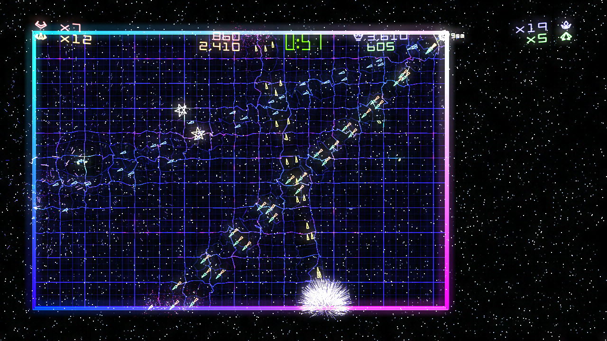

Geometry Wars: Retro Evolved 2, running natively on a stock 64 MB original Xbox. This is the first public release: a beta, so expect rough edges and please report what you find.

## What's in it

- All of the game's single-player modes, and four-player versus and co-op
- Full game speed: 60 game updates a second (58.6 median with four players on a console), drawn at 30 frames a second
- 720p when it is enabled in the dashboard's video settings, otherwise 480p
- Music and sound effects
- Saves on the hard disk (`E:\UDATA\584108FF`), with the game's icon in the dashboard's memory manager, and the game's name and icon on your dashboard
- In-game reset: hold **LT + RT + Back + Black**, or pick **Return to dash** on the main menu

## What you need

- An original Xbox that runs homebrew (softmod or modchip), stock 64 MB, about 140 MB free on the hard disk
- A Windows 10 or 11 PC with [ffmpeg](https://ffmpeg.org) on the PATH (or `ffmpeg.exe` next to `install.ps1`)
- Your own Geometry Wars: Retro Evolved 2 Xbox Live Arcade package (title ID `584108FF`, game version `0.0.1.2`; `default.xex` SHA-256 `6D5D9980A1D17DC74B9CCF540CEC16C2E144E7CEE3A74938E78C237B8ACEEB88`). Other versions are refused.

**No game files are included.** The installer builds everything the game needs from your package.

## Installing

1. Unzip **gw2-xbox-v0.8.0-beta.zip**.
2. In that folder run: `install.cmd "<your LIVE package>" "<new output folder>"` (a few minutes; most of it is converting the sounds).
3. Copy the output folder to the Xbox's hard disk (with FTP, for example to `E:\Games\Geometry Wars 2`).
4. Start `default.xbe` from your dashboard.

## Known issues and limits

- No Xbox Live: the leaderboards show the game's "not available while offline" message, and no achievements are awarded.
- Tested on an Xbox development kit running at 64 MB and in XEMU; not yet on a retail console. Reports are welcome.
- Drawn at 30 frames a second; the game itself runs at its full 60 updates a second.
- Text is in English only for now (the other languages are installed but not used).
- At most 16,000 particles are shown at once (about three times the busiest four-player moment seen), so an extreme explosion cannot run the Xbox out of memory.
- Song 3's music transition has only been checked in the PC sound tester; if the music behaves oddly in a mode, please say which.

## Credits

Built on the [Geometry Wars: Retro Evolved 2 PC port](https://github.com/saulob/geometry-wars-retro-evolved-2-recompiled) by saulob and the [ReXGlue](https://github.com/rexglue/rexglue-sdk) recompiler, with [nxdk](https://github.com/XboxDev/nxdk), tested in [XEMU](https://xemu.app). Geometry Wars: Retro Evolved 2 is by Bizarre Creations. Not affiliated with or endorsed by Microsoft, Activision or Bizarre Creations.
