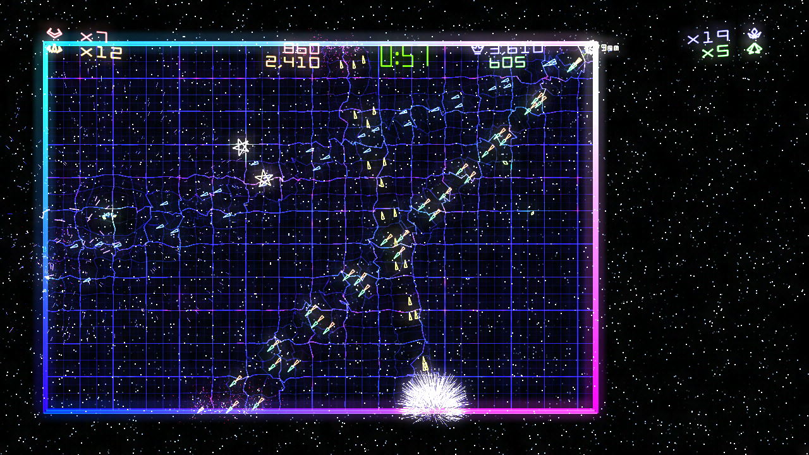

Geometry Wars: Retro Evolved 2 on a stock 64 MB original Xbox, version 0.9.0. This release fixes what players reported on the v0.8.0 beta, steadies the frame rate, keeps your high scores, and moves the sound onto the Xbox's own audio chip.

## What's new since v0.8.0 beta

### Fixes from your reports

- **480p no longer crashes at start.** The picture was laid out wrongly in the Xbox's video memory at 480p widths. 480p, 480i, 720p and 1080i all start and run.
- **High scores are kept.** The original keeps them on Xbox Live, so they were lost. Each mode now has a local top 10 on the hard disk, with arcade initials entered on the game-over screen. Previous Scores shows the initials, and the mode select shows each mode's top three.
- **Slowdown late in a game is much reduced.** See *Speed* below.
- **No more stray shapes over the screen.** Objects just off the screen could be drawn as large wedges across it; they are now kept within the graphics chip's range.

### Speed

- **30 frames a second, the game updating once per frame.** v0.8.0 ran the game's 60 updates a second and drew every second one, and fell behind when the screen got busy. The game now updates 30 times a second, a picture each time. In heavy play on a console it holds about 29 frames a second, with the slowest moments around 23. Under heavy load it draws 15 pictures a second rather than slowing the game down.
- **Sound on the audio chip.** Music and effects are now decoded and mixed by the Xbox's audio chip instead of the processor. That gives back about 9% of the processor in heavy play (3 ms of every frame), most noticeable in the slowest moments.
- **About 40 of the game's busiest routines rewritten** for the Xbox's processor, each checked to give exactly the same results as the original. Particles, outlines and the background grid are faster too.

### Other

- Music no longer falls behind when the game is busy.
- Saves are written to the hard disk straight away.
- Leaving to the dashboard resets the audio chip cleanly for the dashboard.

## What you need

- An original Xbox that runs homebrew (softmod or modchip), stock 64 MB, about 145 MB free on the hard disk
- A Windows 10 or 11 PC with [ffmpeg](https://ffmpeg.org) on the PATH (or `ffmpeg.exe` next to `install.ps1`)
- Your own Geometry Wars: Retro Evolved 2 Xbox Live Arcade package (title ID `584108FF`, game version `0.0.1.2`; `default.xex` SHA-256 `6D5D9980A1D17DC74B9CCF540CEC16C2E144E7CEE3A74938E78C237B8ACEEB88`). Other versions are refused.

**No game files are included.** The installer builds everything the game needs from your package.

## Installing

1. Unzip **gw2-xbox-v0.9.0.zip**.
2. In that folder run: `install.cmd "<your LIVE package>" "<new output folder>"` (about ten minutes; most of it is converting the sounds).
3. Copy the output folder to the Xbox's hard disk (with FTP, for example to `E:\Games\Geometry Wars 2`).
4. Start `default.xbe` from your dashboard.

**Updating from v0.8.0:** install into a new folder and copy it over the old one. Saves stay where they are (`E:\UDATA\584108FF`).

## Known issues and limits

- No Xbox Live: high scores are local, the friends board is empty, and no achievements are awarded. The Leaderboards screen on the main menu was made for Xbox Live and is only partly filled by the local scores.
- A report of picture artifacts at 720p on a 1.1 console could not be reproduced. If you see them, use 480p, and please send a photo and your console's revision.
- The game updates 30 times a second instead of 60. It was made to run at other rates and its clock keeps real time, but if anything feels different from the original (shots, controls), please report it.
- In extreme crowds (hundreds of enemies piled up on screen) the frame rate still drops: drawing that many glowing outlines is more than the graphics chip can do at full speed.
- At most 16,000 particles are shown at once, so an extreme explosion cannot run the Xbox out of memory.
- Text is in English only for now.

## Credits

Built on the [Geometry Wars: Retro Evolved 2 PC port](https://github.com/saulob/geometry-wars-retro-evolved-2-recompiled) by saulob and the [ReXGlue](https://github.com/rexglue/rexglue-sdk) recompiler, with [nxdk](https://github.com/XboxDev/nxdk), tested on a retail Xbox and in [XEMU](https://xemu.app). Geometry Wars: Retro Evolved 2 is by Bizarre Creations. Not affiliated with or endorsed by Microsoft, Activision or Bizarre Creations.
